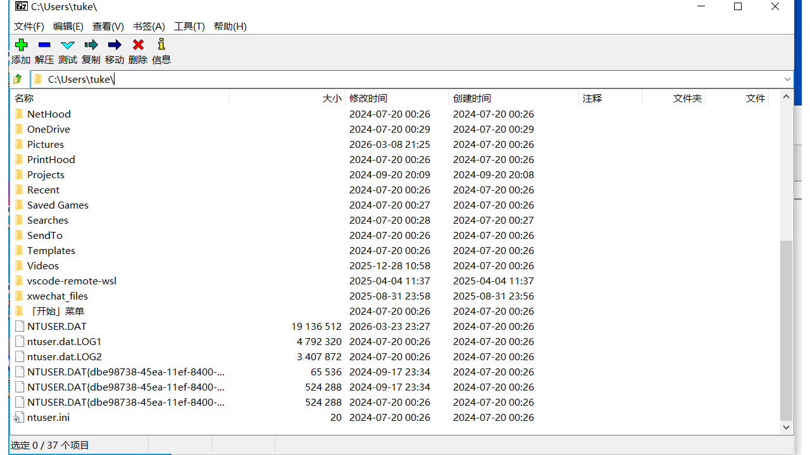
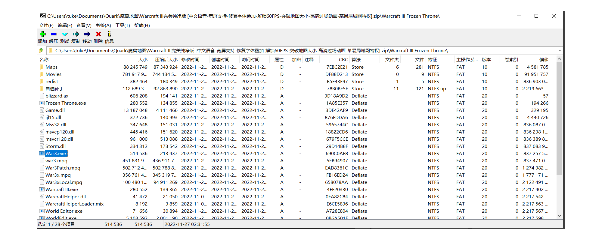

🛠️ 压缩包管理器 rz7z 开发任务 - Part1

## 项目背景与目标
背景：Windows 版本的 7-zip.org 压缩包管理器，精炼极客，但是只有Windows 版本。所以我准备开发一个类似体验的 macOS 版本，补齐桌面生态。

### 本期核心目标：

仅实现 macOS 平台（支持 x86_64 和 arm64）。
优先完成 UI 框架搭建 和 启动流程逻辑。
复用现有的 Rust 压缩/解压逻辑，不重写底层算法。
最终产出：一个可启动、具备基础逻辑的 macOS 应用。

## 技术栈与架构
UI 框架：
使用 gpui 和 gpui-component。
注意：UI 相关代码应编写为跨平台代码，严禁使用 #[cfg(target_os = "macos")] 限定 UI 代码，以便未来扩展。

### 核心逻辑：
复用现有 Rust 实现的压缩、解压、归档函数。
若仓库中找不到具体实现，请补充函数声明并使用 todo!() 占位，不要阻塞整体结构。

## 核心业务逻辑

### 启动流程

应用启动时需根据命令行参数执行不同的逻辑：
场景 A：传入了参数
逻辑：尝试打开参数指定的路径（文件或目录）。
处理：
若为普通目录：进入目录浏览界面（参考 7z-folder.png）。
若为压缩包：进入压缩包预览/管理界面（参考 7z-pkg.png）。
异常：若路径不存在、无权限或格式非法，需弹出符合 macOS 体验的友好错误提示，并退出应用。
场景 B：未传入参数
逻辑：默认打开用户的 主目录 (Home Directory)。
处理：直接进入目录浏览界面。

### 目录浏览

分两种场景：
压缩包内的文件列表：列表项如果是目录，则可以双击点击进去浏览；否则不能双击
文件系统目录的文件列表：列表项如果是目录或压缩包，则可以双击点击进去浏览；否则不能双击

## 开发规范与要求
代码复用：优先搜索并调用现有的 Rust 后端逻辑。
缺失处理：对于缺失的功能接口，必须补充声明并保留 todo!()，保持调用链完整。
模块化：
保持模块清晰，遵循单一职责原则。
方便后续扩展到 Linux 或支持更多文件类型。
错误处理：
必须处理参数不存在、无权限、无法读取等情况。
打开失败后不应停留在空白界面，应提示后退出。

## 交付与验收标准
请直接在现有仓库中修改代码，满足以下标准即视为完成：
编译通过：项目可在 macOS 环境下成功编译。
应用启动：能够启动 macOS 应用。
启动逻辑正确：
无参数时默认打开 Home 目录。
有参数时正确识别文件或目录。
打开失败时有提示并退出。
UI：正确实现UI 设计稿中的UI。
代码质量：UI 代码未硬编码 macOS 平台限定，结构清晰，缺失逻辑已用 todo!() 占位。

## 附件参考
打开目录 UI 设计稿：
打开压缩包 UI 设计稿：
